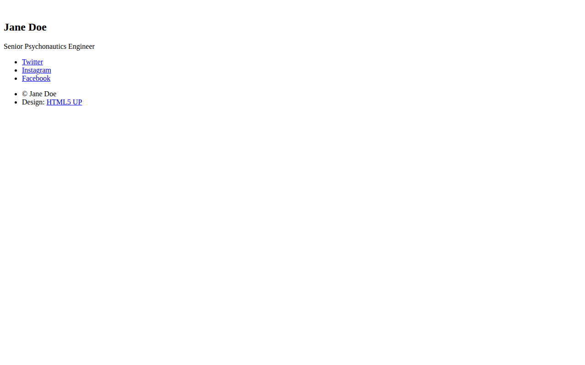

# 🚀 name-card

A personal name card website served by a small Flask application, built from the HTML5 UP "Identity" template. It is the final project of Day 56 of Udemy's "100 Days of Code: The Complete Python Pro Bootcamp", made for course participants and anyone browsing for ideas.

## 📚 Table of Contents

- [Overview](#-overview)
- [Requirements](#-requirements)
- [Setup](#-setup)
- [Run](#-run)
- [Tests](#-tests)
- [License](#-license)
- [Links](#-links)
- [Appendix: Project documents](#-appendix-project-documents)

## 🧭 Overview

The Flask application in `src/name_card/` renders one page at the root route (`/`). The folders follow the course assignment: `templates/` holds the HTML and `static/` holds the CSS, JavaScript, fonts and images. Constants live in `src/name_card/constants.py`, tests in `tests/` and project documents in `docs/`. Source comments use Doxygen syntax and `Doxyfile` builds the API documentation.

### Lecture steps

The wiki explains what each step taught, in [English][wiki], Danish and Bahasa Malaysia.

| Step | What happens | Screenshot |
| --- | --- | --- |
| 1 | Download the Identity template; it works as plain files |  |
| 2 | Flask serves `index.html` at `/`, but the asset paths are wrong |  |
| 3 | The paths point to `static/`; the template renders |  |
| 4 | The card is personalised: name, portrait, links, background |  |

The screenshots are taken in a Docker container with a headless browser: `bash tools/screenshots/run.sh`. No window opens on the desktop.

## 📋 Requirements

- Python 3.13 or newer, to run the application and the tests.
- Flask, the only runtime dependency, to serve the page.
- pytest, only to run the tests.
- Doxygen, optional, only to build the API documentation.
- Docker, optional, only to retake the screenshots.

## 🛠️ Setup

Create and use a local virtual environment named `.venv`, then upgrade pip and install the project with the test extra:

```bash
python -m venv .venv
source .venv/bin/activate        # Linux and macOS
.venv\Scripts\activate           # Windows (cmd or PowerShell)
python -m pip install --upgrade pip
python -m pip install -e ".[test]"
```

Leave the environment with `deactivate`. The `.venv` folder and `.env` are ignored by git.

## ▶️ Run

```bash
python -m name_card
```

Then open <http://127.0.0.1:5000/>.

## 🧪 Tests

```bash
python -m pytest
```

Build the API documentation with `doxygen Doxyfile`; the result is in `docs/doxygen/html/`.

## 📄 License

See [LICENSE][license]. The page design is "Identity" by HTML5 UP ([html5up.net][html5up]), free under the Creative Commons Attribution 3.0 license.

## 🔗 Links

- [Repository][repository]
- [Documentation][documentation]
- [Issue tracker][issues]

## 📎 Appendix: Project documents

The documents a newcomer needs, in reading order.

| Document | What it tells you |
| --- | --- |
| [AGENTS.md][agents] | The rules AI agents follow in this repository |
| [Business Case][BC-001] | Why the project exists, its scope and success criteria |
| [Stakeholder Analysis][SA-001] | Who is involved; the stakeholder IDs used for owners and reviewers |
| [Project Plan][PP-001] | The gateways and their schedule |
| [Milestones][milestones] | One document per gateway: Go/No-Go criteria and tasks |
| [Artifact registry][registry] | Where each artifact type lives, the next version, the PO language and domain |
| [Traceability matrix][TM-001] | How the artifacts link and when each was last reviewed |
| [Framework README][framework-readme] | The framework this project uses |
| [Framework changelog][framework-changelog] | What changed in each framework release |

---

[wiki]: https://git.tirsystem.com/Tirsvad-Udemy-100-days-of-code/056-name-card/wiki
[license]: ./LICENSE
[html5up]: https://html5up.net
[repository]: https://git.tirsystem.com/Tirsvad-Udemy-100-days-of-code/056-name-card
[documentation]: https://git.tirsystem.com/Tirsvad-Udemy-100-days-of-code/056-name-card/wiki
[issues]: https://git.tirsystem.com/Tirsvad-Udemy-100-days-of-code/056-name-card/issues
[agents]: ./AGENTS.md
[BC-001]: ./docs/business-case.md
[SA-001]: ./docs/stakeholder-analysis.md
[PP-001]: ./docs/project-plan.md
[milestones]: ./docs/milestones/
[registry]: ./docs/artifact-registry.md
[TM-001]: ./docs/sqa/traceability-matrix.md
[framework-readme]: ./framework/README.md
[framework-changelog]: ./framework/CHANGELOG.md
