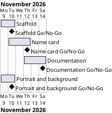

# Project Plan

## Metadata
| Key | Value |
| --- | --- |
| ID | PP-001 |
| CrossReference | [BC-001], [SA-001], [MIL-001], [MIL-002], [MIL-003], [MIL-004] |
| Language | en |
| Domain | it |

## Version History
| Date | Status | Author | Reviewer | Change | Commit |
| --- | --- | --- | --- | --- | --- |
| 2026-11-09 | Accepted | Jens Tirsvad Nielsen | S01 (AI as stand-in) | Initial version | [9d708b8] |
| 2026-11-09 | Accepted | Jens Tirsvad Nielsen | S01 (AI as stand-in) | Add MIL-004 portrait and background | [29d7a1b] |

---

## Purpose

This plan schedules the three gateways of the 056-name-card project: the project scaffold, the personalised name card, and the documentation. The Business Case sets no fixed duration, so the plan fits the project into one week.

## Planning Assumptions

- Week 1 starts 2026-11-09; the plan ends by 2026-11-16.
- Each gateway is one branch and one pull request that closes the issues of its tasks.
- S01 is owner and approving reviewer of every gateway; the AI acts as stand-in reviewer in autonomous mode and records it on each review (source: [SA-001]).
- Screenshots are taken in a Docker container, not on the host desktop.

## Gateway Schedule

| Gateway | Document | Window | Decision date | Owner | Stories | Main deliverable | Milestone |
| --- | --- | --- | --- | --- | --- | --- | --- |
| Scaffold | [MIL-001] | 2026-11-09 to 2026-11-10 | 2026-11-10 | S01 | none (technical tasks) | Python project skeleton with configuration, tooling and passing smoke test | not yet synced |
| Name card | [MIL-002] | 2026-11-10 to 2026-11-12 | 2026-11-12 | S01 | none (technical tasks) | Flask application serving the personalised Identity template at `/`, with tests | not yet synced |
| Documentation | [MIL-003] | 2026-11-12 to 2026-11-14 | 2026-11-14 | S01 | none (technical tasks) | README, screenshots per lecture step, three-language wiki, repository description and topics | not yet synced |
| Portrait and background | [MIL-004] | 2026-11-09 to 2026-11-10 | 2026-11-10 | S01 | none (technical tasks) | Centred portrait and a software development, AI and ML background, screenshot and docs updated | not yet synced |



## Scope Coverage

| Business Case scope item | Gateway |
| --- | --- |
| Flask application with one root route | [MIL-002] |
| Identity template assets, personalised content and photo | [MIL-002] |
| `src/`, `tests/`, `docs/`, `pyproject.toml`, `constants.py`, `.gitignore`, Doxyfile, README skeleton | [MIL-001] |
| README and wiki screenshots per lecture step, wiki in en, da and ms | [MIL-003] |
| Portrait fix and software development, AI and ML background (change request from S01) | [MIL-004] |

## Dependencies

```
MIL-001 → MIL-002 → MIL-003 → MIL-004
```

A No-Go on a gateway stops the later gateways until the finding is fixed and the gateway is reviewed again; the end date then moves by the rework time. S01 decides a move of the end date.

## Plan Risks

| Risk | Impact | Mitigation |
| --- | --- | --- |
| The template download link has expired | Delay in [MIL-002] | Use the public html5up demo or ask S01 |
| Docker is not available for screenshots | Delay in [MIL-003] | Stop and report; no fallback to the host desktop |
| Translation work takes longer than planned | Delay in [MIL-003] | English is written first; da and ms follow page by page |

## Open Issues

- None.

---

[BC-001]: ./business-case.md
[SA-001]: ./stakeholder-analysis.md
[MIL-001]: ./milestones/mil-001-scaffold.md
[MIL-002]: ./milestones/mil-002-name-card.md
[MIL-003]: ./milestones/mil-003-documentation.md
[MIL-004]: ./milestones/mil-004-portrait-and-background.md
[9d708b8]: https://git.tirsystem.com/Tirsvad-Udemy-100-days-of-code/056-name-card/commit/9d708b837307d80c2675f65cdaed97c31d0bd133
[29d7a1b]: https://git.tirsystem.com/Tirsvad-Udemy-100-days-of-code/056-name-card/commit/29d7a1b6c94f38f99dc9162eab32b3b29f9c3374
